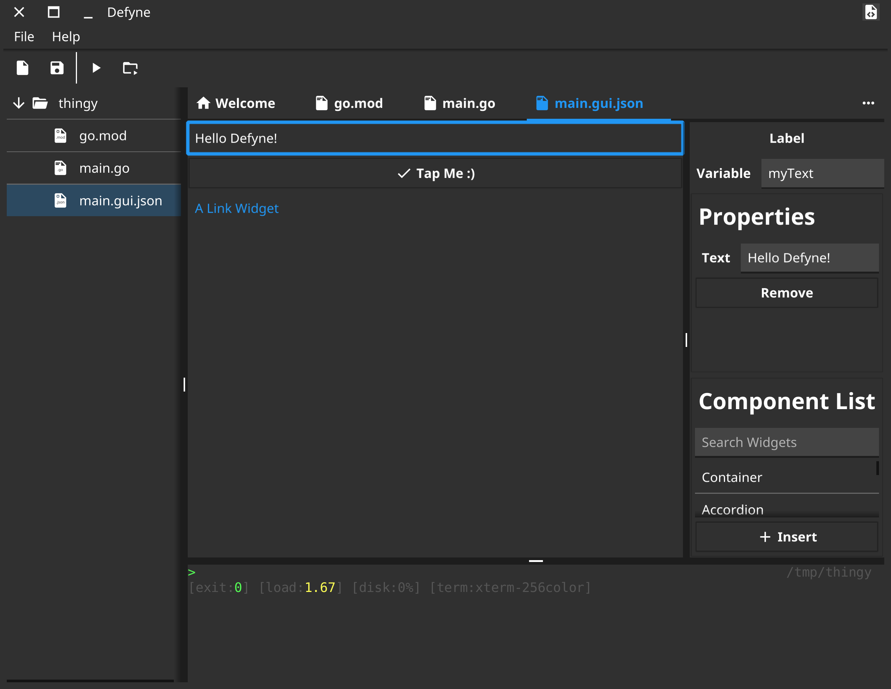

# granio-studio

Компонент независимого проекта **Granio — Гранио**.

**Исходный репозиторий:** [defyne](https://github.com/fyne-io/defyne).
**Цель форка:** Среда разработки приложений Granio.

История изменений, лицензии и сведения об исходных авторах сохранены.
Go-модули переведены на собственные пути `github.com/Uzer007-admin/…`;
минимальная версия Go — **1.27.1**. Ядро и общие API подключаются из
[`granio/v2`](https://github.com/Uzer007-admin/granio).

Состояние переноса и результаты проверок приведены в
[реестре экосистемы](https://github.com/Uzer007-admin/granio/blob/dev/granio/docs/ECOSYSTEM.md).
Наличие форка само по себе не означает проверку всех платформ и сценариев.

---

## Документация исходного проекта

Команды установки и ссылки в сохранённом тексте ниже относятся к исходнику.
Для Granio используются новые пути модулей, перечисленные выше.

# DEFyne

This repo contains historical initial work on a Fyne IDE.

The ability to work with JSON representation of Fyne widgets has
been split out to a new project, [refyne](../refyne).

Efforts to build Fyne IDE have largely move to the [Apptrix.ai](https://apptrix.ai) project.

## Features

* Embedded terminal
* GUI Editor
* Image preview

## Screenshot

## Installation

Can be installed directly using standard go tools:

	$ go install -v github.com/fyne-io/defyne@latest
